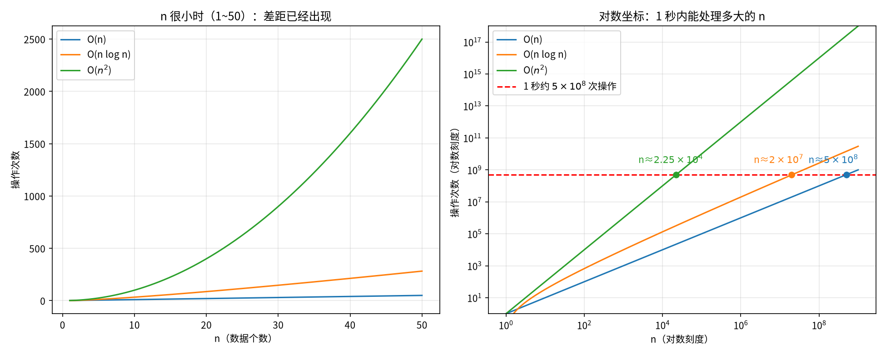

# 2026-10-26 算法性能分析

今天把代码随想录的“算法性能分析”这一部分看完了。内容可以归成三类：时间复杂度（程序为什么会超时、递归为什么会爆炸），空间复杂度（调用栈和额外申请的内存），以及内存本身的底层机制（栈和堆、内存对齐）。最后还预习了明天要做的二分查找。

---

## 一、时间复杂度：程序为什么会超时

### 1. 1 秒能做多少事

这一节要解决的问题是：拿到一道题，怎么判断自己的写法会不会超时。

判断的方法不是只看复杂度的“名字”，而是把题目给的 n 代进去，估一下操作次数。一般 1 秒大约能做 5×10⁸ 次基本操作。反过来算，每种复杂度在 1 秒内能处理的 n 大概是这样：

| 复杂度 | 1 秒内大约能处理的 n |
|---|---|
| O(n) | 5×10⁸ |
| O(n log n) | 2×10⁷ |
| O(n²) | 2.25×10⁴（两万多） |

下面这张图把三条曲线画在一起。左边是 n 比较小的时候，n² 一下就冲上去了；右边是对数坐标，红色虚线就是“1 秒”，三条线碰到红线的位置就是上表里的三个数。



比如题目说 n ≤ 10⁵，O(n²) 就是 10¹⁰ 次，肯定超时，这时就该去想 O(n log n) 或 O(n) 的做法。

记住：看到数据范围，先把 n 代进复杂度里算一下次数，超过 10⁸ 量级就要换思路。

### 2. log 的底数为什么不用写

这一节回答的是：O(log n) 里的 log 到底以几为底。

在算法里，log 通常是以 2 为底的，log₂n 的意思是“n 要除以几次 2 才变成 1”。比如 8 ÷ 2 ÷ 2 ÷ 2 = 1，除了 3 次，所以 log₂8 = 3；1024 要除 10 次，所以 log₂1024 = 10。

不过底数换成别的，只会差一个固定倍数：

```
log₂n = log₂10 × log₁₀n      （log₂10 ≈ 3.32，是个常数）
logᵢn = logᵢj × logⱼn        （换成任意底数也一样）
```

比如 n = 1000，log₁₀1000 = 3，log₂1000 ≈ 9.97，正好约等于 3 × 3.32。大 O 本来就不管常数倍（O(2n) 也写成 O(n)），所以底数干脆省掉。

记住：底数只影响一个常数倍，不影响增长快慢，统一写 O(log n)。

### 3. 快速排序到底是 O(n log n) 还是 O(n²)

这一节要说清楚的是：同一个算法，为什么在不同输入下复杂度不一样。

快排每一轮挑一个基准，把比它小的放左边、比它大的放右边，每一层都要把所有数看一遍，所以一层的工作量大约是 n，总时间就是“层数 × n”。

运气好的时候，每次正好对半分。比如 8 个数：8 → 4 → 2 → 1，只要 3 层，也就是 log₂8 层，总共约 n log n。

运气差的时候，比如数组已经有序（1 2 3 4 5 6 7 8），又总拿第一个数当基准，每次只能切掉一个数：

```
第 1 层：[1] | 2 3 4 5 6 7 8     切掉 1 个，剩 7 个
第 2 层：[2] | 3 4 5 6 7 8       切掉 1 个，剩 6 个
...
一共 n 层，每层约 n 次 → n + (n-1) + ... + 1 ≈ n²/2 → O(n²)
```

拿 1024 个数算一下：对半分是 10 层 × 1024 ≈ 1 万次；每次只切 1 个是 1024 × 1024 ≈ 100 万次，差了 100 倍。插入排序也是同样的道理：有序时 O(n)，逆序时 O(n²)。

严格按大 O 的定义（任何输入下的上界），快排是 O(n²)。但平时说快排是 O(n log n)，指的是平均情况，而且实际写快排会随机选基准，最坏情况几乎碰不到。

记住：平时说的复杂度默认是一般情况，较真的时候要分清最好、平均、最坏。

### 4. 字符串排序：一次比较也有代价

这一节的问题是：给 n 个长度为 m 的字符串，找出两个相同的，要多久。

做法是先按字典序排序，相同的字符串就会挨在一起，比如 `dog, cat, dog, ant` 排完是 `ant, cat, dog, dog`，再从头扫一遍、比较相邻的两个就找到了。

排序要比较 n log n 次，但比较两个字符串不是一步，而是要一个字一个字对，最多 m 次，所以排序是 O(m × n × log n)。扫一遍要比 n 次，每次 m，是 O(n × m)。加起来是 O(m × n × log n + n × m)，后一项更小，最后写成 O(m × n × log n)。暴力两两比较是 O(m × n²)，所以先排序更快。

记住：算复杂度时，“一次操作”本身要几步也要乘进去。

### 5. 快速幂：function3 和 function4

这一节要解决的问题是：算 x 的 n 次方，O(n) 为什么还不够好，以及“看起来减半了”的写法为什么不一定快。

最直接的递归是每次把 n 减 1：xⁿ = xⁿ⁻¹ × x，要调用 n 次，是 O(n)。面试官期待的是每次把 n 减半，比如 2¹⁶ = (2⁸)²，2⁸ = (2⁴)²……16 次方只要 4 步，n 是 10 亿时也只要 30 步左右，也就是 O(log n)。

但减半有一个陷阱。看 function3：

```cpp
int function3(int x, int n) {
    if (n == 0) return 1;
    if (n == 1) return x;
    if (n % 2 == 1) {
        return function3(x, n / 2) * function3(x, n / 2) * x;
    }
    return function3(x, n / 2) * function3(x, n / 2);
}
```

它确实每次把 n 除以 2，但同一个 `function3(x, n / 2)` 写了两遍，每个节点都会开出两个分支。比如 n = 16，画出调用树：

```
              f(16)                 1 次
          /          \
       f(8)          f(8)           2 次
      /    \        /    \
    f(4)  f(4)    f(4)  f(4)        4 次
    ... 每个再分两个 ...              8 次
  f(1) f(1) ... 共 16 个             16 次

合计 1 + 2 + 4 + 8 + 16 = 31 次，约 2n → O(n)
```

层数虽然只有 log n，但每往下一层调用次数翻一倍，节点总数还是和 n 同一个量级。

function4 的改法只有一处：先把一半的结果算一次，存到 t 里，再拿 t 来乘。

```cpp
int function4(int x, int n) {
    if (n == 0) return 1;
    int t = function4(x, n / 2);       // 只算一次
    if (n % 2 == 1) return t * t * x;  // n 是奇数，多乘一个 x
    return t * t;
}
```

这样调用树就变成了一条链，每层只往下走一个分支：

```
f(16) → f(8) → f(4) → f(2) → f(1) → f(0)
每层调用 1 次，一共约 log n 层 → O(log n)
```

比如 n = 3 走一遍：先算 t = function4(x, 1)，它内部又算 function4(x, 0) = 1，再因为 1 是奇数，返回 1 × 1 × x = x，所以 t = x¹。回到 n = 3，3 是奇数，返回 t × t × x = x × x × x = x³。

如果 function4 不写 `int t`，而是直接写 `return function4(x, n/2) * function4(x, n/2) * x;`，那它就和 function3 一模一样，又退回 O(n) 了。两者都区分了奇偶，真正的区别只在于有没有把结果存起来复用。

记住：先算一次，结果复用；递归的次数要数整棵树的节点，不能只看层数。

### 6. 斐波那契版本一：递归怎么爆炸

这一节说明的是：一个看起来很短的递归，为什么会慢到算不动。

斐波那契数列是 0, 1, 1, 2, 3, 5, 8……每个数等于前两个数之和，直接翻译成递归就是：

```cpp
int fibonacci(int i) {
    if (i <= 0) return 0;
    if (i == 1) return 1;
    return fibonacci(i - 1) + fibonacci(i - 2);
}
```

比如算 f(4)，调用树是这样的：

```
                f(4)
            /          \
         f(3)          f(2)
        /    \        /    \
     f(2)   f(1)   f(1)   f(0)
    /    \
  f(1)  f(0)
```

数一下：f(4) 调 f(3)、f(2)；f(3) 调 f(2)、f(1)；两个 f(2) 各调 f(1)、f(0)。总共 1 + 2 + 2 + 4 = 9 次。同样地，n = 2 时只有 f(2)、f(1)、f(0) 共 3 次；f(5) 是 15 次。可以看到 f(2) 在 f(4) 里被算了两遍，f(1) 被算了三遍，重复计算非常多。

总调用次数有个规律：等于 2 × fib(n+1) − 1（这里 fib(1) = fib(2) = 1）。验证一下：n = 2 时 2 × 2 − 1 = 3，n = 4 时 2 × 5 − 1 = 9，n = 5 时 2 × 8 − 1 = 15，都对得上。斐波那契数本身大约按 φⁿ 增长（φ ≈ 1.618，黄金分割比），所以调用次数的紧界是 O(φⁿ)。平时常说的 O(2ⁿ) 是一个比较宽松的上界，因为每个节点最多开两个分支。

那能不能学快速幂，把结果存进变量就变快？不行。快速幂里两次调用算的是同一个值，所以能复用；这里 fib(n−1) 和 fib(n−2) 是两个不同的值，都得算，存进变量也省不掉任何一次调用。

记住：每个调用分出两个“不同的”子调用，次数就会指数级爆炸。

### 7. 斐波那契版本二：滚动传参

这一节解决的是：怎么让斐波那契不再重复计算。

思路是把“前两个数”当成参数一路往下传，就像手算时只记着最后两个数，往后推一步、再推一步：

```cpp
int fibonacci(int first, int second, int n) {
    if (n <= 0) return 0;
    if (n < 3) return 1;
    else if (n == 3) return first + second;
    else return fibonacci(second, first + second, n - 1);
}
```

调用时写 `fibonacci(1, 1, n)`。比如 n = 5：

```
fibonacci(1, 1, 5)
  → fibonacci(1, 2, 4)      first 变成旧的 second，second 变成两数之和
  → fibonacci(2, 3, 3)      n == 3，返回 2 + 3 = 5
```

第 5 个数正是 5。每次只调用自己一次，是一条直线，所以时间是 O(n)。

记住：把要用的中间结果当参数带下去，就能把指数级变成线性。

---

## 二、空间复杂度：程序跑起来占多少内存

### 1. 空间复杂度指的是什么

这一节先把概念说清楚。空间复杂度说的是程序运行时额外占用的内存有多大，而不是编译出来的执行文件有多大。有些程序本身很小，跑起来却要占很多内存。

### 2. new int[n]：额外内存随 n 线性增长

比如下面这段 C++ 代码，先申请一块能放 n 个整数的内存，再依次填上 0 到 n−1：

```cpp
int* a = new int[n];          // 申请 n 个 int 的格子，a 记住它的地址（指针）
for (int i = 0; i < n; i++) { // i 从 0 数到 n-1，一共 n 次
    a[i] = i;
}
```

用 Python 写差不多就是 `a = [0] * n` 再循环赋值。比如 n = 10，填完是这样：

```
下标:  a[0] a[1] a[2] a[3] a[4] a[5] a[6] a[7] a[8] a[9]
内容:   0    1    2    3    4    5    6    7    8    9
```

循环条件是 `i < n`，所以 i 最大到 9，最后一个格子是 a[9]，没有 a[10]。格子数正好是 n 个，n 变大占用就按比例变大，所以空间复杂度是 O(n)。如果只用了 i 这样几个变量，不管 n 多大都只占几格，那就是 O(1)。

原文写的是 `new int(n)`，用的是圆括号，这在 C++ 里的意思是“申请 1 个整数，把值设成 n”，应该是笔误。

记住：方括号 `new int[n]` 才是开 n 个格子，圆括号 `new int(n)` 只开 1 个。

### 3. 递归的空间看深度，不看节点数

这一节要解决的问题是：递归树有那么多节点，空间是不是也跟着爆炸。

答案是不会。递归不是一次把整棵树展开，而是一条路先走到底。每调用一次函数，就往“调用栈”上放一层，记住“这个函数算到一半，在等结果”；函数返回了，这一层就拿走。比如算 f(5)，沿最左边走到底的那一刻，栈里是这样：

```
   栈口 →  | f(1) |   ← 最后放上去，最先拿走
           | f(2) |
           | f(3) |
           | f(4) |
   栈底 →  | f(5) |
```

f(1) 返回后被拿走，f(2) 再去调用 f(0)，放上去、算完、拿走……整棵树有 15 个节点，但同一时刻最多只摞着 5 层。f(n) 的最大深度是 n，所以版本一的空间复杂度是 O(n)，而它的时间是指数级。

版本二也一样，调用链 fibonacci(…, n) → fibonacci(…, n−1) → … 深度约为 n，所以空间同样是 O(n)。

记住：递归的时间看节点总数，空间看树的深度。

---

## 三、内存：栈、堆和对齐

### 1. 栈和堆

这一节回答：程序里的数据到底放在哪。

函数里的普通变量和函数调用本身放在栈上，由系统自动分配、自动回收，速度快但空间有限，递归太深就会“栈溢出”。用 new 申请的内存放在堆上，空间大，但要自己用 delete 释放，忘了释放就会内存泄漏。

| | 栈 | 堆 |
|---|---|---|
| 谁来管 | 系统自动分配、自动回收 | 自己 new，自己 delete |
| 速度 | 快 | 相对慢 |
| 大小 | 有限 | 大得多 |
| 典型内容 | 局部变量、函数调用 | new 出来的数组、对象 |

```
  栈（自动）                    堆（手动）
 +-----------+               +---------------------+
 | i         |               | a[0] a[1] ... a[9]  |
 | a (指针) -+-------------->|                     |
 +-----------+               +---------------------+
 函数结束自动消失               要 delete[] a 才释放
```

比如前面的 `int* a = new int[n];`，指针 a 本身在栈上，它指向的 n 个格子在堆上。

记住：new 了就要 delete，栈上的东西函数结束会自动清掉。

### 2. sizeof 和内存对齐

这一节解决的问题是：一个结构体占多少字节，为什么不是成员大小直接相加。

看这段代码：

```cpp
struct node {
    int num;
    char cha;
} st;
int main() {
    int a[100];
    char b[100];
    cout << sizeof(int) << endl;   // 4
    cout << sizeof(char) << endl;  // 1
    cout << sizeof(a) << endl;     // 400
    cout << sizeof(b) << endl;     // 100
    cout << sizeof(st) << endl;    // 8
}
```

| 表达式 | 输出 | 原因 |
|---|---|---|
| sizeof(int) | 4 | 一个 int 占 4 字节 |
| sizeof(char) | 1 | 一个 char 占 1 字节 |
| sizeof(a) | 400 | 100 个 int，100 × 4 |
| sizeof(b) | 100 | 100 个 char，100 × 1 |
| sizeof(st) | 8 | 4 + 1 = 5，再补 3 字节对齐到 8 |

前四个直接相乘就行，最后一个按理说是 4 + 1 = 5，实际却是 8，这就是内存对齐：

```
| num num num num | cha pad pad pad |   = 8 字节
   int 占 4 字节      char 1 字节 + 补 3 字节
```

原因是 CPU 读内存不是一个字节一个字节读，而是按固定宽度一块一块读，数据的地址最好是自身宽度的倍数。结构体的大小会被凑成最大成员（这里是 int，4 字节）的整数倍，这样在数组里一个接一个排的时候，每个 num 都能落在对齐的位置上，读起来快。现在内存很便宜，但 CPU 读取对齐和不对齐的速度差距还在，所以编译器默认补齐；真想省空间，也可以自己控制对齐方式。

记住：结构体的实际大小可能比成员加起来大，多出来的是对齐补的空字节。

### 3. double 和 float

顺带记一下：double 是双精度浮点数，占 8 字节；float 是单精度，占 4 字节。double 精度更高，平时写题一般用 double。

---

## 附：二分查找预习

这一节为明天的 704 题做准备：在一个有序数组里，怎么用 O(log n) 的时间找到一个数。

做法是每次看中间那个数：要找的数比它小，就把右半边丢掉；比它大，就把左半边丢掉；相等就找到了。每次丢掉一半，n 个数最多看 log n 次，所以是 O(log n)。

比如在 [1, 3, 5, 7, 9, 11, 13] 里找 9，L 和 R 是下标（位置），不是数值：

```
下标:   0   1   2   3   4   5   6
数值:   1   3   5   7   9  11  13
        L           mid         R      mid = 0 + (6-0)/2 = 3，arr[3]=7 < 9，丢左边，L = mid+1 = 4

下标:   4   5   6
数值:   9  11  13
        L  mid  R                      mid = 4 + (6-4)/2 = 5，arr[5]=11 > 9，丢右边，R = mid-1 = 4

下标:   4
数值:   9
       L=R=mid                         mid = 4，arr[4]=9，找到
```

最后一步就是 R == L 的情况：只剩一个位置，检查它，相等就找到；不相等的话 L 和 R 会错开（L > R），循环结束，说明不存在。mid − 1、mid + 1 指的都是下标位置，所以就算数组里的数不连续（像上面 1, 3, 5…），写法也一模一样。

中间位置的正确写法是：

```cpp
int mid = L + (R - L) / 2;
```

为什么不直接写 (L + R) / 2？因为 int 最大约是 2147483647（2³¹ − 1）。比如 L = 2000000000、R = 2100000000，L + R = 4100000000，已经超出 int 范围，会溢出变成错误的数；而 L + (R − L) / 2 = 2000000000 + 50000000 = 2050000000，全程都不会超。

另外，取数组元素用方括号 `arr[mid]`；箭头 `->` 是指针指向结构体时取成员用的，比如 `p->num`，两者别混。

记住：mid = L + (R − L) / 2，L、R、mid 都是下标。

---

## 我踩的坑

快速幂里，n 每次减半不等于一定是 O(log n)。function3 把同一个 `function3(x, n/2)` 调了两次，每层调用数翻倍，n=16 时一共 31 次，还是 O(n)。先用 t 存一次，再 t × t，才是真的 O(log n)。

递归的空间不是递归树的节点总数。同一时刻只摞着从根到当前位置的那一条链，空间看的是深度。

new int(n) 和 new int[n] 容易混。圆括号是开 1 个整数、值设为 n；方括号才是开 n 个格子。

---

## 进度

今天学完算法基础，明天开始数组。
