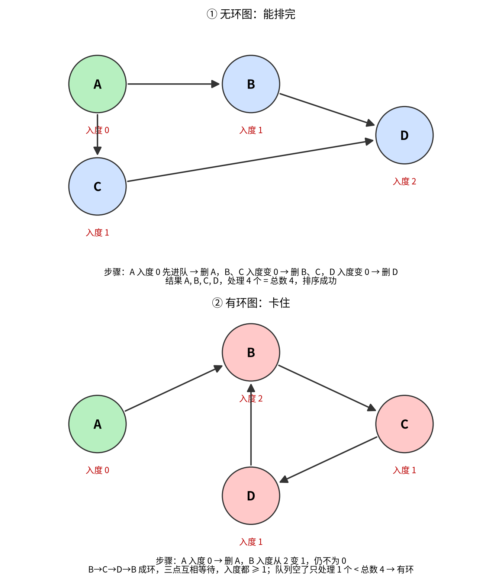
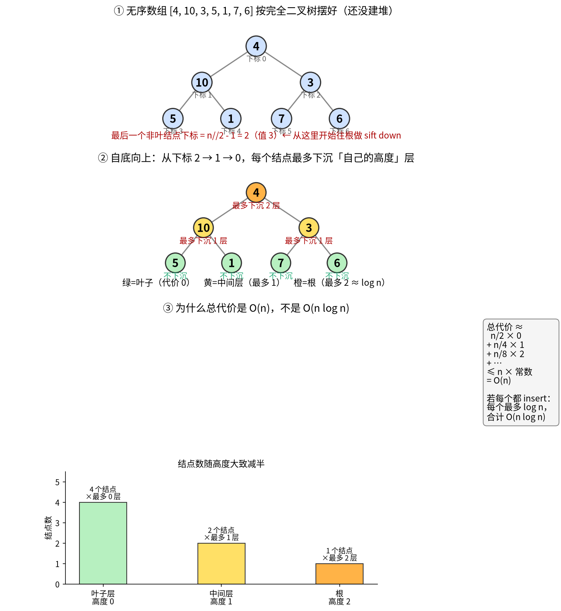

# 2026-10-31 · NVIDIA SWQA（测试开发）笔试面经

岗位：测试开发（Software QA）实习向笔试。整体难度中等：选择偏概念，编程偏工程小工具，没有很难的算法竞赛题。题干多为英文。

考察面大致是：

- 数据结构 / 算法：并查集判环、Kahn 拓扑与有向环、外排序场景、自底向上建堆 O(n)
- 系统基础：Unix 标准文件描述符、mutex 与信号量
- Agent / 工程规范：按需加载 Skill、多层仓库指令优先级
- 服务质量：流式结果校验、吞吐 vs 单请求延迟（TTFT）
- 动手题：`find` 找大文件、配置合并、临时环境变量上下文、分页 REST API

---

## 选择题（1–10）

### 1. 并查集判环（Union-Find Cycle Detection）

**题意**：无向图一条条加边，用并查集处理。加边 `(u, v)` 前检查两端的根。哪种情况说明加这条边会成环？

**答案**：`u` 和 `v` 已经有同一个代表元（根相同）。

**要点**：根相同 = 已在同一连通块，再连必成环。根不同则合并，不成环。

**干扰方向**：有没有 parent、边数奇偶，都不是判环条件。

---

### 2. Kahn 拓扑排序与有向环

**题意**：Kahn 不断删入度为 0 的点。队列空了，处理过的点数却少于图的总点数，说明什么？

**答案**：图里至少有一个有向环。

**要点**：剩下的点入度都大于 0，互相卡住。图不连通但无环时，仍能陆续处理完所有点。



---

### 3. 外排序（External Merge Sort）

**题意**：QA 流水线要排一个远大于内存的多 TB 事件文件，机器只能顺序读写临时磁盘文件。什么时候该用外归并排序？

**答案**：数据集装不进内存，只能先排成磁盘大小的有序块，再多路归并时。

**干扰项大意**（拍照有截断）：

- 输入已全局有序且不能改
- 每条记录都能进 CPU 缓存且可随机访问
- 只要立刻拿到第一条未排记录

---

### 4. 自底向上建堆复杂度

**题意**：对任意数组用 bottom-up heapify 建二叉最小堆，最坏时间复杂度？

**答案**：`O(n)`。

**要点**：从最后一个非叶往根 sift down。叶子多、下沉距离短；越往上结点越少。总代价线性。一个个 `insert` 才是 `O(n log n)`。



参考视频：

- [Complexity of Heapify is O(N)](https://www.youtube.com/watch?v=PGFlgZhpHs8)（约 3 分钟直觉）
- [Build Heap in O(n)](https://www.youtube.com/watch?v=C4qrYnzPw3k)
- [【408】堆排序建堆过程模拟](https://www.bilibili.com/video/BV1wK421Y7fv/)（中文过程演示）

---

### 5. 标准文件描述符

**题意**：Unix 标准文件描述符对应关系？

**答案**：`0=stdin`，`1=stdout`，`2=stderr`。

---

### 6. Mutex vs 信号量

**题意**：多线程更新同一内存结构；临界区同一时刻只能一个线程；且加锁的线程必须是解锁的那个。用哪种同步原语？

**答案**：互斥锁（mutex）。

**干扰项大意**（拍照有截断）：

- 不带锁的条件变量
- 计数信号量
- 可同时持有的读锁

**要点**：信号量一般不强制「谁 acquire 谁 release」；条件变量要配锁；读锁允许多读者。

---

### 7. Agent Skill 加载

**题意**：Agent 有多个可复用 Skill（含 `api-test-design` 等）。用户要从 OpenAPI 出 API 用例，该怎么加载？

**答案**：只选 `api-test-design`，读完完整说明再动手。不要把无关 Skill 全加载，也不要跳过说明直接写。

---

### 8. 仓库指令优先级（Repository Instructions and Precedence）

**题意**：编码 Agent 要改模块并跑检查。仓库有根说明、模块有更具体说明、用户又加了本次约束；Agent 还没读任何一份。动手前该怎么做？

**答案**：把适用的说明都读完，再按权威和路径远近解决冲突，然后再改代码或跑工作流。

**要点**：三层都要看；不能只认一层，也不能先改再回头对说明。

---

### 9. 流式结果校验

**题意**：流式客户端偶发重复或丢字，非流式输出是对的。哪种测试信号最强？

**答案**：按顺序记录流式事件，再和正确的非流式完整结果对照。

**要点**：只比开头、只 join、只断言每个 chunk，信号都更弱。

---

### 10. 吞吐 vs 单请求延迟（TTFT）

**题意**：并发升高时，连续批处理提高整机每秒总 token，但单请求的 TTFT 和令牌间延迟变差。这矛盾吗？

**答案**：不矛盾。批处理可以提高系统吞吐，同时让单请求延迟变差。

**名词**：

- **TTFT**（Time To First Token）：从发请求到吐出第一个字的时间（多久开始回答）
- **令牌间延迟**：开始回答后，相邻两个字之间隔多久（字蹦得快不快）
- **连续批处理**：服务器把多人请求拼在一起算（像公交车一路上下客），整车吞吐↑，个人可能要排队、路上更慢

---

## 编程题（11–14）

### 11. 找大于 1 MiB 的文件

**要求**：递归检查目录，报告每个严格大于 1,048,576 字节的普通文件。

- 输入目录：`/tmp/swqa-large-file-audit/input`
- 输出文件：`/tmp/swqa-large-file-audit/large-files.txt`
- 每行：`字节数 相对路径`（不要前导 `./`）；按大小降序，大小相同按路径升序；无表头；不改输入；可用 bash/`find`/`sort`/`stat`，不要 sudo

**参考命令**：

```bash
find /tmp/swqa-large-file-audit/input -type f -size +1048576c -printf '%s %P\n' | sort -k1,1nr -k2,2 > /tmp/swqa-large-file-audit/large-files.txt
```

**易错**：`find` 和路径之间要有空格；`-size` 用 `+1048576c`；`-printf` 的格式要用引号包完整。

---

### 12. 合并配置默认值（mergeConfiguration）

**要求**：用 override 合并 defaults。同名 key 只改值、不挪位置；新 key 按 override 顺序追加。返回 `key=value` 字符串列表；不要改四个输入列表。

例：defaults `a=1,b=2` + overrides `b=3,c=4` → `["a=1","b=3","c=4"]`

**参考**：

```python
def mergeConfiguration(defaultKeys, defaultValues, overrideKeys, overrideValues):
    result = []
    index = {}
    for k, v in zip(defaultKeys, defaultValues):
        index[k] = len(result)
        result.append(k + "=" + v)
    for k, v in zip(overrideKeys, overrideValues):
        item = k + "=" + v
        if k in index:
            result[index[k]] = item
        else:
            index[k] = len(result)
            result.append(item)
    return result
```

**易错**：逻辑必须写在官方 `def` 里面；`return result` 要缩进进函数；四个参数名不要截断；下面平台脚手架不要改。

---

### 13. 临时环境变量上下文管理器

**要求**：实现 `temporary_environment(name, value)`。进入时设置环境变量；退出时还原旧值，原先没有则删除；函数体抛异常时也要还原；不要吞异常。

**参考**：

```python
@contextmanager
def temporary_environment(name, value):
    import os
    had = name in os.environ
    old = os.environ.get(name)
    os.environ[name] = value
    try:
        yield
    finally:
        if had:
            os.environ[name] = old
        else:
            os.environ.pop(name, None)
```

---

### 14. 电影标题分页 API（getMovieTitles）

**要求**：请求 `https://jsonmock.hackerrank.com/api/movies/search/`，参数 `Title=substr`，翻完所有页；收集每条的 `Title`；不区分大小写排序（相同再按原串）；没有结果返回 `[]`。用 `requests`，超时 5 秒，读 body 前先 `raise_for_status()`。

**参考**：

```python
import requests

def getMovieTitles(substr):
    titles = []
    page = 1
    total_pages = 1
    while page <= total_pages:
        r = requests.get(
            "https://jsonmock.hackerrank.com/api/movies/search/",
            params={"Title": substr, "page": page},
            timeout=5,
        )
        r.raise_for_status()
        data = r.json()
        total_pages = int(data.get("total_pages") or 0)
        for item in data.get("data") or []:
            titles.append(item["Title"])
        page += 1
    titles.sort(key=lambda t: (t.lower(), t))
    return titles
```

---

## 复习方向（测开向，不是纯竞赛）

1. **数据结构（题 1–4）**：代码随想录图论/并查集以后再看；visuAlgo 看并查集与堆；LeetCode 标签 `union-find`、`topological-sort`、`heap`
2. **Linux / 并发（题 5–6、11、13）**：鸟哥基础篇（重定向、`find`/`sort`）；Python `threading.Lock`、`contextlib.contextmanager`、`os.environ`
3. **HTTP / API（题 14）**：状态码 + `requests` 分页、超时、`raise_for_status` 固定模板
4. **测试与工程习惯（题 7–9）**：从契约做 API 测试；流式结果用「有序事件 vs 完整对照」记
5. **性能直觉（题 10）**：吞吐（系统）≠ 延迟（单用户）；批处理常换吞吐、伤延迟

**两周实用节奏（每天约 1 小时）**

- 周一到三：并查集 / 拓扑 / 堆复杂度各一小节 + 各 1 道简单题
- 周四：Linux `find`/`sort` + 环境变量小练习
- 周五：`requests` 分页模板 + mutex 概念
- 周末：把错题用自己的话补进本笔记

---

## 备注

- 部分选择题选项照片被屏幕裁切，干扰项只记了能看清的开头。
- 编程参考代码用于复习，正式笔试仍应自己敲、自己改。
- 更新：2026-10-31（Asia/Shanghai）· via leetcode
